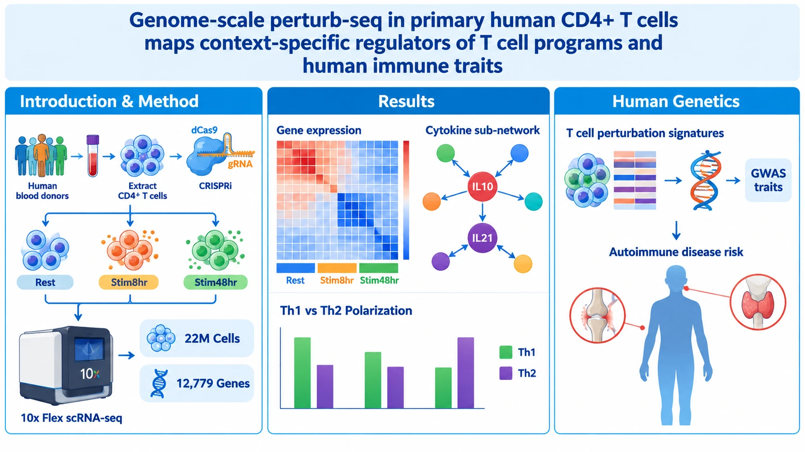

**Cell**：本研究利用 CRISPRi 与 10x 单细胞测序，对约 2200 万个原代人类 CD4+ T 细胞进行全基因组规模 Perturb-seq 分析。通过对比静息及刺激后 8/48 小时的动态变化，构建了 T 细胞基因调控网络图谱。研究发掘了 IL-10/IL-21 等细胞因子的新调控因子，预测了 Th1/Th2 极化及衰老相关的驱动基因，并将扰动特征与人类自身免疫疾病风险变异相映射。亮点有三：首创原代细胞全基因组规模 + 多时序动态图谱（4 名供体、12,779 个基因，揭示刺激条件特异性调控）；单基因级别解析精度（MEN1、NFKB2、KDM1A 等新调控因子，阵列验证）；打通真实人类队列（OneK1K）与 UK Biobank GWAS，为自身免疫疾病遗传风险位点找到 T 细胞中的潜在机制（如 FAM20B）。

> 首发于小红书（2026-11-05）· [查看原文](https://www.xiaohongshu.com/explore/6aebf108000000000700234c)
