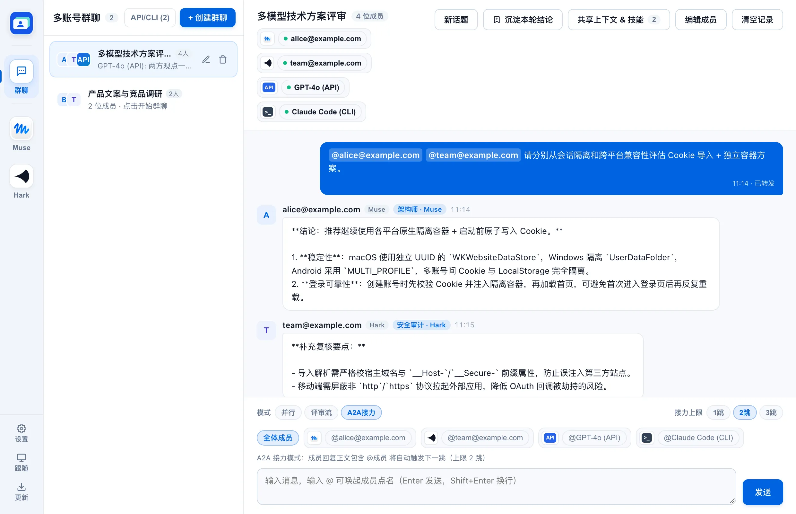

**github项目分享：叠号**：叠号（Multi-Agent Account Manager）：基于 Tauri 2 的跨平台 AI 助手多账号管理工具，macOS / Windows / Android / iOS 四端覆盖，把 Muse、Hark 等多个 AI 账号隔离开、快速切换，还能拉进同一个群聊协作。亮点：原生级隔离，各系统原生 WebView 隔离机制，独立 Cookie 与存储，账号互不干扰、不串号；多账号群聊，并行讨论、评审流、A2A 接力三种模式，@成员/@渠道/@全体点名，共享上下文与技能；端到端加密同步，局域网扫码直传、Cloudflare 零知识中转、WebDAV 加密云同步，密钥不上传；Cookie 导入登录，粘贴 JSON、cookies.txt 或 Cookie 请求头直接进入已登录状态，绕过内嵌 Google OAuth 限制，自动识别邮箱；重度使用细节，同代理防限流保活、额度检测间隔可调、工具权限自动审批（拦截删除/支付等高危操作）、登录异常一键清理重登、快捷键切号。注意：未用付费代码签名，macOS 首次打开可能报 Gatekeeper 拦截、Windows 可能触发 SmartScreen，iOS 需自签安装。Apache-2.0 协议开源，332 stars。仓库地址：https://github.com/ldjx7/multi-agent-account-manager

> 首发于小红书（2026-11-27）· [查看原文](https://www.xiaohongshu.com/explore/6b0919a3000000002903c651)
