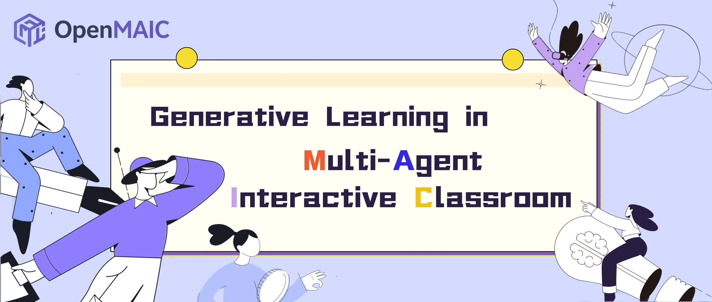

**github项目分享：OpenMAIC**：清华大学 THU-MAIC 团队开源的 OpenMAIC：一个多智能体互动课堂平台，把任意主题或文档一键生成为带 AI 教师、AI 助教和 AI 同学的沉浸式课堂。亮点：多智能体课堂，AI 教师、助教和不同人设的 AI 同学实时授课、讨论、辩论，还原真实课堂的参与感；场景丰富，幻灯片、随堂测验加 AI 批改、HTML 交互式模拟实验、项目制学习（PBL），从“听”转向“做”；多模态表达，语音讲解、白板实时绘图和书写公式；厂商中立，支持 OpenAI、Anthropic、Gemini、DeepSeek 等主流模型，openmaic.yml 按环节灵活指定；融入工作流，OpenMAIC Skill 可在飞书、Slack、Telegram 等 20 多个聊天应用或 IDE 里一键生成课堂；导出灵活，可编辑 PPTX、能离线播放的单个 HTML、课堂 ZIP，课程级撤销，服务端生成，关页面也不中断。MIT 协议开源，支持 Docker 与自托管部署。仓库地址：https://github.com/THU-MAIC/OpenMAIC

> 首发于小红书（2026-11-27）· [查看原文](https://www.xiaohongshu.com/explore/6b08dd76000000002b01e803)
