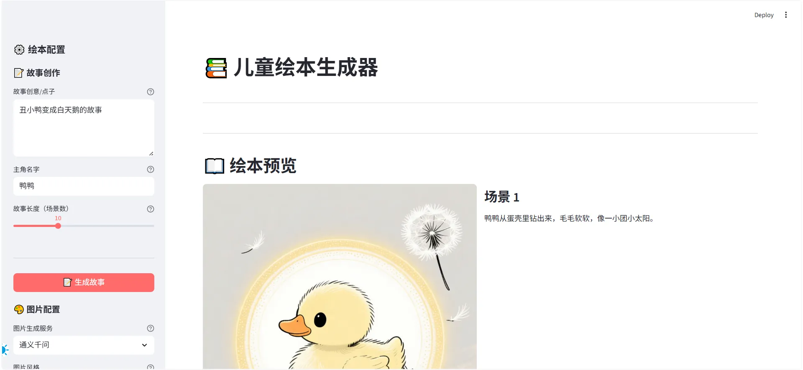

**github项目分享：儿童绘本**：给 3–5 岁孩子做 AI 绘本的开源工具：开发者送给女儿 Cloud 的礼物，本地跑的 Web 应用，Python + Streamlit，一句话创意就能生成一本插图风格一致、中英双语的 PDF 绘本。用法极简：输入一个创意种子，比如“怕黑的宇航员”，给角色起个名，选故事长度 1–30 个场景；AI 自动写故事、逐页画插画、翻译成英文、排版成 PDF，可直接发到 Kindle 上读；8 种艺术风格：漫画、动画、中国传统、水彩、卡通、油画等。亮点：全链路闭环，想法 → 故事 → 插画 → 双语文本 → 排版 PDF，一次拿到成品，不用在多个工具间拼接；门槛极低，Python 3.11+ 加一个 API Key 就能跑，通义千问新手推荐、有免费额度，豆包图片生成更快；适合家长和老师，给孩子做专属睡前故事，或做课堂材料。MIT 协议开源。仓库地址：https://github.com/cn-vhql/StoryCraft

> 首发于小红书（2026-11-27）· [查看原文](https://www.xiaohongshu.com/explore/6b08f6f10000000018026102)
