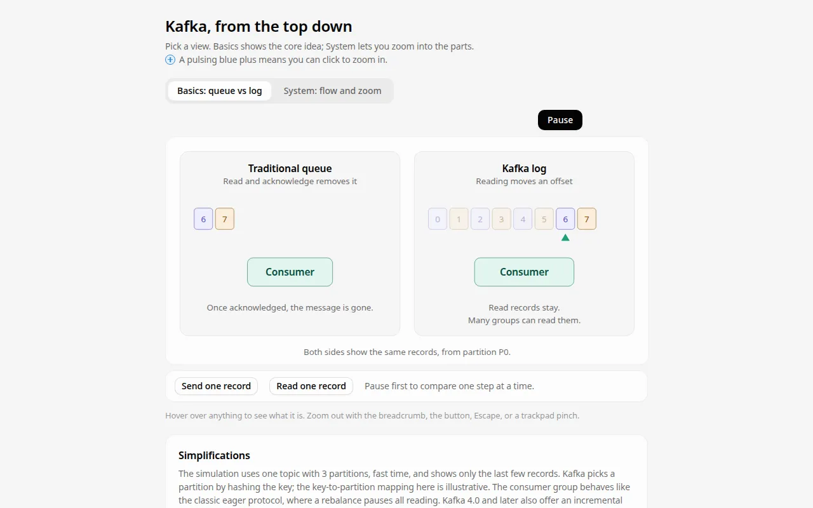

**ai skill：可视化学习**：一个让 AI 把任意主题变成可交互动画教学页面的开源 Skill：纯 Markdown 指令（SKILL.md 为核心），不是独立软件，不绑定模型或工具。两种形态：引导式演练像迷你视频播放器，分章节逐步构建，带字幕、进度条、倍速、章节按钮，每步后自动暂停；交互式探索器同一底层模型多视角切换，下钻、参数控制、通俗悬停提示，比如 Kafka 队列与日志的差异。亮点：提案-审查-修复闭环，动手前先查信源、提 2–3 个方案等你选，每做完一个模块独立审查子代理从事实准确性、教学效果、浏览器实际表现三方面核验，修完复检并报告修了什么、跳过什么；事实溯源，每个事实都查真实信源，每页都列出参考来源；零构建，产物都是单文件 HTML，深浅色自适应，本地 HTTP 服务就能打开；模型无关，只要会读写文件、联网搜索、写 HTML 就能用。MIT 协议开源。仓库地址：https://github.com/andrewalumkal/VisualLearning.Skill

> 首发于小红书（2026-11-27）· [查看原文](https://www.xiaohongshu.com/explore/6b08f1dd000000002a0117e7)
