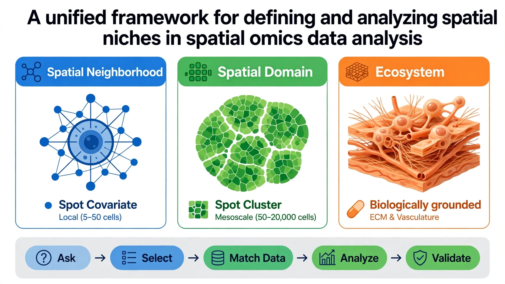

**Nature Genetics**：“空间生态位（spatial niche）”是空间组学里最常用的词之一，但它的定义一直不统一：同一份数据，换一种 niche 的定义，分析单位和分析结论都可能不一样。Nature Genetics 2026 年 11 月新发表的 Perspective（Pan Liu、Jingyi Jessica Li）系统梳理了文献，提出了一个统一框架，把混乱的 niche 概念归为三类，并给出可操作的决策流程。三类定义，尺度与用途各不相同：空间邻域（Spatial Neighborhood）是锚点细胞或位点周围的局部环境，约 5–50 个细胞/位点，适合刻画局部细胞间互作，常作为位点协变量使用；空间域（Spatial Domain）是空间上相邻、分子特征相似的位点聚类，中尺度约 50–20,000 个细胞/位点，适合发现新的组织结构与分区；生态系统（Ecosystem）是细胞与非细胞成分（细胞外基质、血管等）共同构成的生物学微环境，适合研究组织稳态与疾病。文章同时明确了两种分析角色：niche 可以作为位点协变量，也可以作为位点聚类。术语建议上，作者主张把“niche”一词留给最符合生物学本意的生态系统，而把前两者分别称为 spatial neighborhood 和 spatial domain。文章给出了五步决策框架：提问 → 选择定义 → 匹配数据 → 分析 → 验证，并区分了单细胞分辨率平台（如 Xenium、CosMx）与多细胞分辨率平台（如 Visium）的不同处理方式。未来方向包括 3D 重建、空间多组学与 AI 基础模型（如 Nicheformer）。亮点：这是空间组学方法学/概念框架类文章，不是针对某个病种的原创研究，它的价值在于给全领域提供了一套“通用语言”，让不同研究的方法与结论可以放在同一框架下比较，提高空间组学研究的可重复性。

> 首发于小红书（2026-11-18）· [查看原文](https://www.xiaohongshu.com/explore/6afd5023000000002b0324a9)
