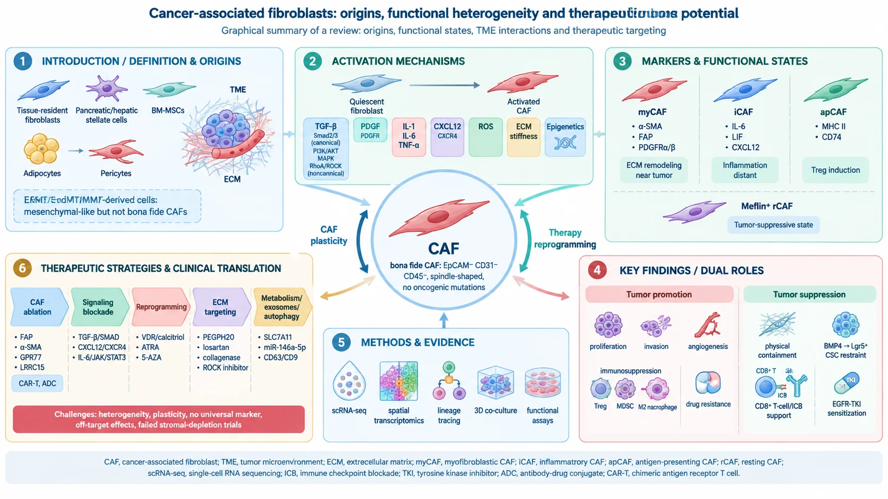

**Signal Transduction and Targeted Therapy**：该综述系统梳理癌相关成纤维细胞（CAF）的起源、活化机制、标志物、功能异质性与治疗潜力。文章强调 bona fide CAF 的严格定义（EpCAM⁻CD31⁻CD45⁻、纺锤形、无致癌突变），区分 EMT/EndMT/MMT 来源细胞；归纳 TGF-β、PDGF、炎症因子、ECM 硬度等活化通路；解析 myCAF、iCAF、apCAF 等动态状态及促瘤/抑瘤双重功能。治疗理念从“清除 CAF”转向“重编程/正常化 CAF”，并反思 FAP CAR-T、TGF-β 抑制剂、PEGPH20 等临床转化失败教训；系统纳入单细胞与空间转录组，解析 CAF 亚型与免疫抑制微环境。

> 首发于小红书（2026-11-02）· [查看原文](https://www.xiaohongshu.com/explore/6ae809c4000000001201f609)
